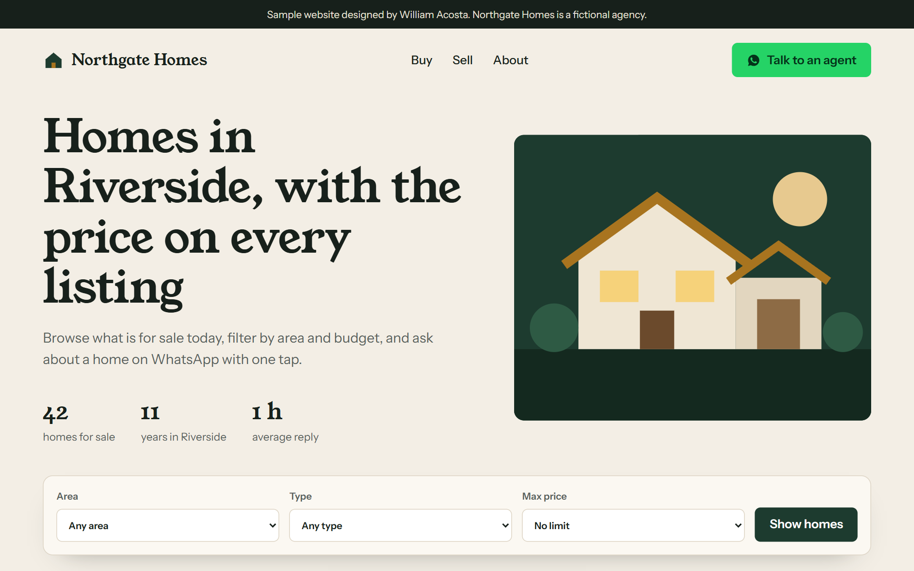
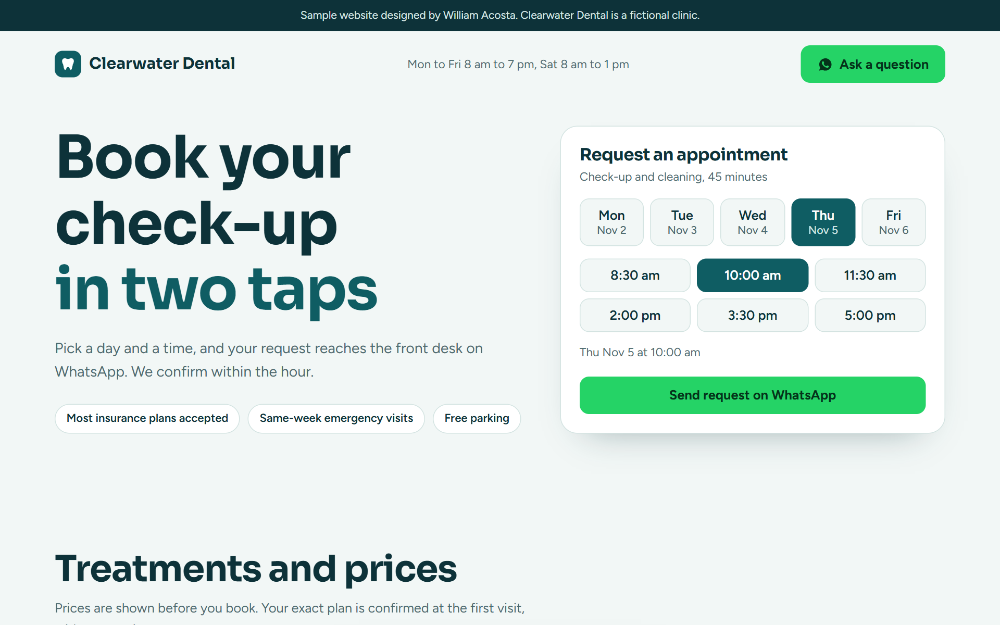

# Sitios web de ejemplo

Cuatro sitios de muestra para pequeños negocios, cada uno en un solo archivo HTML con CSS y JavaScript sin dependencias. Los negocios, los precios y las personas son **inventados**: sirven para mostrar cómo trabajo.

*English: four sample websites for small businesses (real estate, dental clinic, grill restaurant, grocery store). Single-file HTML, CSS and vanilla JavaScript, mobile-first, no build step. All businesses are fictional.*

| Sitio | Qué muestra | En vivo |
|---|---|---|
| [Inmobiliaria](inmobiliaria/index.html) (en inglés) | Listado de propiedades con filtros por zona, tipo y precio; cada propiedad tiene su botón de consulta por WhatsApp con la propiedad ya nombrada | [ver](https://william-demos.web-estudio.workers.dev/ejemplos/realestate/) |
| [Consultorio odontológico](odontologia/index.html) (en inglés) | Selector de día y horario para pedir turno, tratamientos con precio, equipo y preguntas frecuentes | [ver](https://william-demos.web-estudio.workers.dev/ejemplos/dental/) |
| [Parrilla](parrilla/index.html) | Menú por categorías, sugerencias del día, carrito de pedido y reserva de mesa por WhatsApp | [ver](https://william-demos.web-estudio.workers.dev/ejemplos/parrilla/) |
| [Tienda de barrio](tienda/index.html) | Catálogo con buscador y ofertas, carrito con total en guaraníes y pedido que llega armado por WhatsApp | [ver](https://william-demos.web-estudio.workers.dev/ejemplos/tienda/) |

## Cómo están hechos

- Pensados primero para el celular, sin scroll horizontal y con botones grandes.
- Sin librerías: HTML semántico, CSS con variables y JavaScript simple para filtros, carrito y selector de turnos.
- Accesibles: foco visible con teclado, ilustraciones con descripción para lectores de pantalla y respeto por "reducir movimiento".
- En los ejemplos, los botones de WhatsApp muestran el mensaje que se enviaría en lugar de abrir un chat real.

Para verlos, abrí cualquier `index.html` en el navegador.
